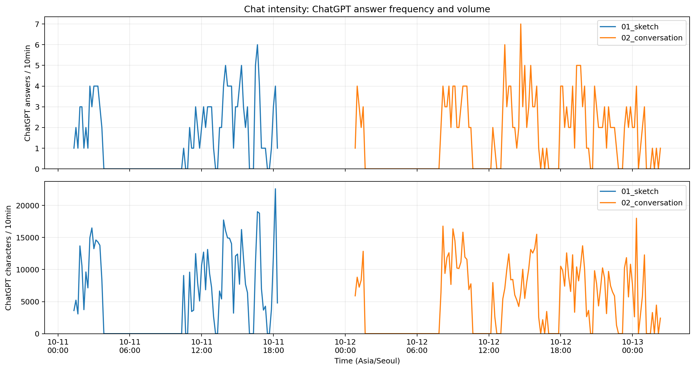

# A Question for DJT

도널드 트럼프에게 우크라이나 전쟁의 종전과 그 이후의 유럽 안보, 미국의 국익에 관해 묻는 글입니다.

- **[01_sketch](01_sketch/sketch.pdf)**: 영어 원문. 젤렌스키 교체와 우크라이나의 협상력 약화를 가정한 뒤, 종전 이후에도 미국의 방위 부담이 줄어드는지 질문합니다.
- **[02_conversation](02_conversation/readme.pdf)**: 원문을 대통령과 지니의 대화로 재구성한 글. 원문 인용과 네 번의 가상 실험을 교차 편집하며, 각 선택 이후에 남는 문제를 살펴봅니다.

두 글은 각 폴더에서 Markdown과 PDF로 읽을 수 있습니다. 나머지 `01_sketch-writing`과 `02_conversation-writing` 폴더에는 사전 조사, 집필 기록, 한국어판, 프롬프트와 AI 대화 기록 등 작성 과정 자료를 담았습니다.

아래 그래프는 두 대화에서 ChatGPT의 답변 수(위)와 글자 수(아래)를 10분 단위로 집계한 것입니다. 가로축은 한국 시간입니다.

분석 코드: [Jupyter 노트북](03_aftermath/02_python/chat_intensity.ipynb)
